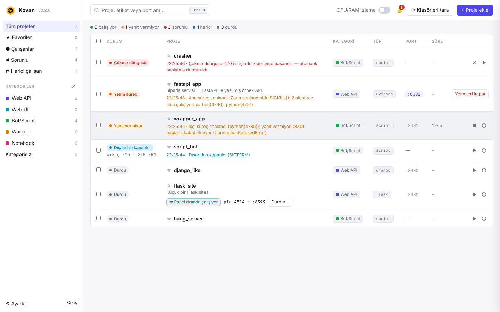
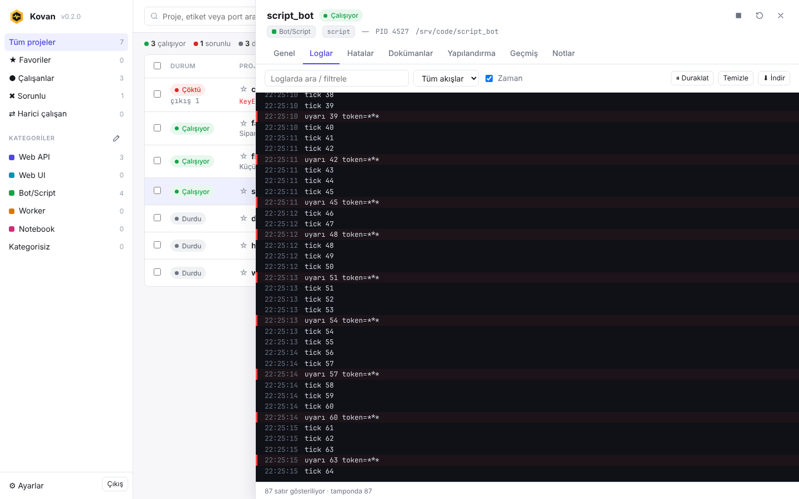
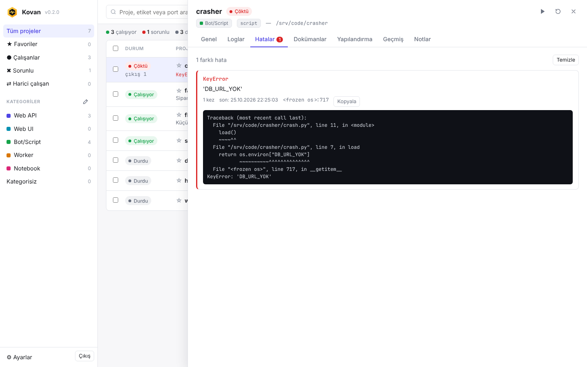
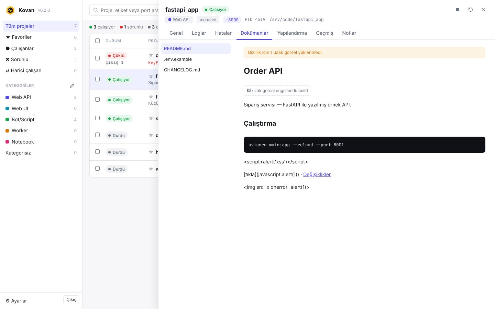
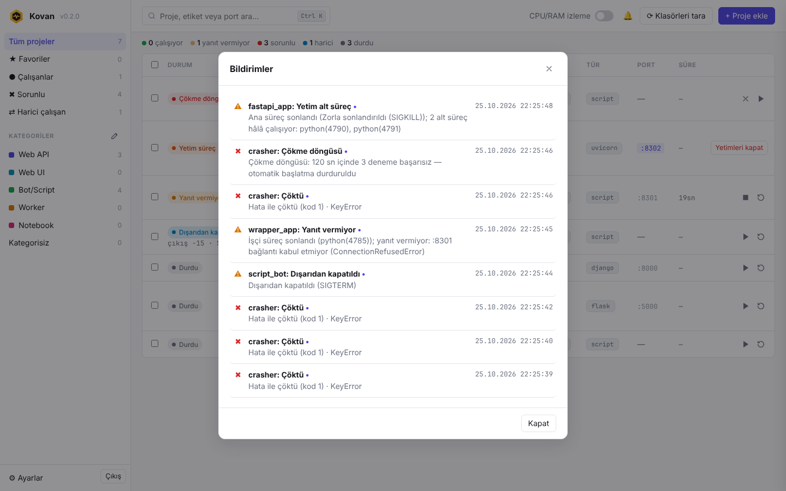
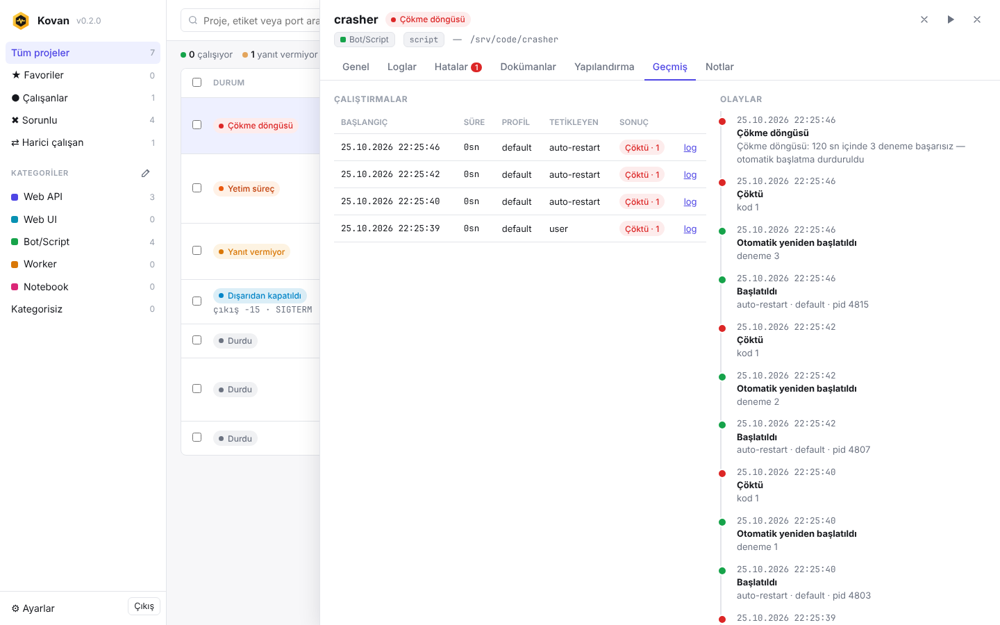
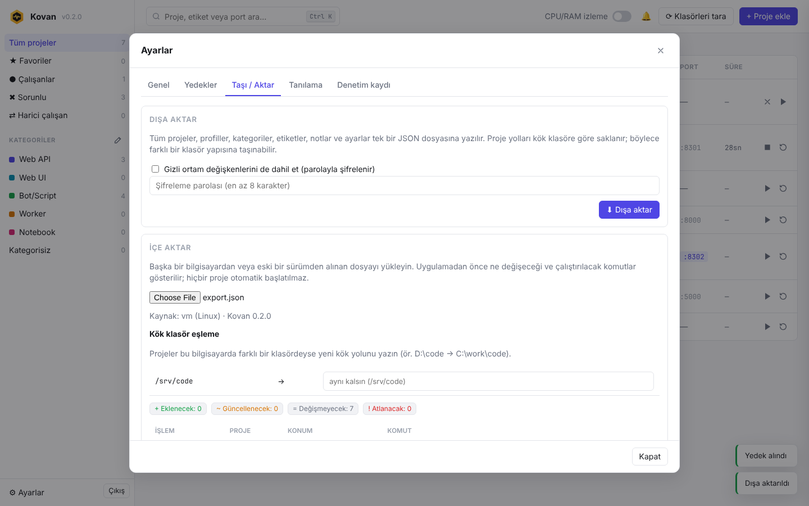

<p align="center">
  <picture>
    <source media="(prefers-color-scheme: dark)" srcset="assets/logo-wordmark-dark.svg">
    
  </picture>
</p>

<p align="center">
  <a href="https://github.com/ferhatcicek/kovan/actions/workflows/ci.yml"></a>
  
  
  <a href="LICENSE"></a>
</p>

**Kovan**, `D:\code` gibi bir klasördeki Python projelerini **tek bir yerel web panelinden** başlatmanızı, durdurmanızı
ve izlemenizi sağlar. Her proje için ayrı CLI penceresi açmanıza gerek kalmaz: komut satırında göreceğiniz tüm çıktı
ve hatalar panelde canlı akar; hangi projenin çalıştığını, hangi portu dinlediğini, neden durduğunu ve isteğe bağlı
olarak ne kadar CPU/RAM kullandığını tek ekranda görürsünüz.



## Öne çıkanlar

- **Her çalıştırma biçimi:** `python x.py`, `python -m paket`, `uvicorn main:app`, `flask run`, `manage.py runserver`,
  `streamlit run` ve `{python}` / `{port}` yer tutuculu özel komut. Yorumlayıcı otomatik bulunur
  (`.venv` → `uv run` → sistem) veya elle seçilir.
- **Canlı loglar ve hatalar:** stdout/stderr, ANSI renkleri, arama, indirme; Python traceback'leri otomatik gruplanır.
- **Portlar:** gerçekte dinlenen portlar gösterilir, başlatmadan önce çakışma engellenir, tek tıkla boş port önerilir.
- **Süreç gözetimi:** bir uygulama çökerse, başka bir program tarafından kapatılır veya öldürülürse, ya da canlı
  olduğu hâlde yanıt vermezse Kovan bunu saniyeler içinde **nedeniyle** algılar, bildirir ve isterseniz otomatik
  yeniden başlatır.
- **Kategoriler, etiketler, favoriler, profiller (dev/prod), toplu işlemler, proje notları.**
- **Proje dokümanları:** README, CHANGELOG, `docs/*.md` panelde güvenle okunur.
- **Yapılandırma kaybolmaz:** otomatik yedekler, güvenli migrasyonlar, taşınabilir dışa/içe aktarma.
- **Güvenli varsayılanlar:** yalnızca `127.0.0.1`, parola, CSRF/Origin denetimi, katı CSP, kabuksuz komutlar.

## Kurulum

```bash
python -m venv .venv
.venv\Scripts\activate             # Linux/macOS: source .venv/bin/activate
pip install git+https://github.com/ferhatcicek/kovan.git
kovan --root D:\code
```

Tarayıcı `http://127.0.0.1:8765` adresinde açılır. İlk açılışta bir parola belirlersiniz, ardından
**Klasörleri tara** ile projeleriniz bulunur (dosyalar yalnızca okunur, proje kodu çalıştırılmaz).

| Parametre | Açıklama |
|---|---|
| `--root YOL` | İzinli kök klasör (tekrarlanabilir). Kovan yalnızca bu klasörlerin içindeki projelere erişir. |
| `--port 8765` | Panel portu (yalnızca 127.0.0.1 üzerinde dinler). |
| `--data-dir YOL` | Veri dizini (varsayılan `%LOCALAPPDATA%\Kovan`, Linux'ta `~/.local/share/kovan`). |
| `--no-browser` | Tarayıcıyı otomatik açma. |

### Windows uygulaması (.exe)

Hazır paket [Releases](https://github.com/ferhatcicek/kovan/releases) sayfasındadır. Kendiniz derlemek için:

```bat
packaging\build_windows.bat
dist\Kovan\Kovan.exe --root D:\code
```

`Kovan.exe` yanına boş bir `kovan.portable` dosyası koyarsanız tüm veriler o klasörde tutulur (taşınabilir mod).

## Süreç gözetimi

| Durum | Ne zaman |
|---|---|
| **Dışarıdan kapatıldı** | Başka bir program süreci nazikçe kapattı (SIGTERM, Ctrl+C, konsol kapatma, kod 0) |
| **Öldürüldü** | SIGKILL, Görev Yöneticisi / `taskkill /F` |
| **Çöktü** | Python hatası (traceback) veya beklenmedik çıkış kodu |
| **Yanıt vermiyor** | Süreç canlı ama asıl işçi öldü (uvicorn `--reload`, venv başlatıcısı, `uv run`) veya sağlık kontrolü başarısız |
| **Yetim süreç** | Ana süreç bitti, alt süreçler portu tutmaya devam ediyor — "Yetimleri kapat" ile temizlenir |
| **Yeniden başlatılıyor / Çökme döngüsü** | Otomatik yeniden başlatma (üstel bekleme, deneme sınırı) |
| **Devralındı** | Kovan yeniden açıldığında hâlâ çalışan süreç tanınır ve izlenir |
| **⇄ Panel dışında çalışıyor** | Proje klasöründe Kovan dışından başlatılmış süreç |

Her olay 🔔 bildirim merkezine ve isteğe bağlı masaüstü bildirimine düşer; projenin **Geçmiş** sekmesinde
çalıştırma sonuçları ve olay zaman çizelgesi tutulur. Sağlık kontrolü, otomatik yeniden başlatma ve bildirimler
proje bazında (**Yapılandırma → Gözetim**) veya kategori bazında ayarlanır.

## Yapılandırma: yedek, güncelleme ve taşıma

- Veriler uygulama klasörünün dışında tutulur; güncelleme veriye dokunmaz. Şema değişiklikleri otomatik ve atomik
  uygulanır, öncesinde tam yedek alınır. Okunamayan bir kayıt silinmez, karantinaya alınır.
- Günlük ve her riskli işlemden önce otomatik yedek; ayrıca her değişiklikte okunabilir bir JSON kopyası.
- Tek dosyalık dışa/içe aktarma: proje yolları kök klasöre göre saklanır, başka bir bilgisayarda
  `D:\code → C:\work\code` gibi eşlenir. Gizli değerler istenirse parolayla şifrelenir (scrypt + AES-256-GCM).

```bash
kovan doctor                                    # veri dizini, şema, bütünlük, yedekler
kovan backup                                    # elle yedek
kovan restore                                   # yedekleri listele; kovan restore <ad> ile geri yükle
kovan export -o kovan-config.json               # dışa aktar (gizliler hariç)
kovan export -o cfg.json --include-secrets      # gizliler parolayla şifrelenerek dahil
kovan import cfg.json --map "D:\code=C:\work\code" --dry-run   # önce ne olacağını gör
kovan import cfg.json --map "D:\code=C:\work\code"             # uygula
```

Aynı işlemler panelde **Ayarlar → Yedekler / Taşı-Aktar** altından da yapılabilir.

## Ekran görüntüleri

| Loglar | Hatalar | Dokümanlar |
|---|---|---|
|  |  |  |
| **Bildirimler** | **Geçmiş ve olaylar** | **İçe aktarma önizlemesi** |
|  |  |  |

## Güvenlik

Kovan komut çalıştırabildiği için varsayılanlar sıkıdır: yalnızca `127.0.0.1`, Host başlığı doğrulaması,
argon2id parola, CSRF ve Origin denetimi, katı CSP, `shell=False`, izinli kök klasörlerle sınırlı dosya erişimi,
temizlenmiş Markdown, PID + oluşturulma zamanı doğrulamalı süreç sonlandırma. İçe aktarılan dosyalar güvenilmeyen
girdi sayılır. Ayrıntılar ve açık bildirme: [SECURITY.md](SECURITY.md).

## Geliştirme

```bash
pip install -e ".[dev]"
ruff check src tests
pytest
```

Mimari ve tasarım kararları [docs/TASARIM.md](docs/TASARIM.md), katkı kuralları [CONTRIBUTING.md](CONTRIBUTING.md),
sürüm notları [CHANGELOG.md](CHANGELOG.md) dosyasındadır.

> **Windows notu:** Geliştirme ve testlerin büyük bölümü Linux üzerinde yapıldı; Windows'a özgü davranışlar (Job
> Object, Ctrl+Break, Görev Yöneticisi ile sonlandırma) birim testleriyle kapsanır ve CI'da Windows üzerinde de
> testler çalışır.

## Yol haritası

· paket bağımlılık analizi 
· yığınlar (bağımlılık sıralı toplu başlatma) 
· birleşik log görünümü 
· zamanlayıcı.

## Lisans

[MIT](LICENSE)
